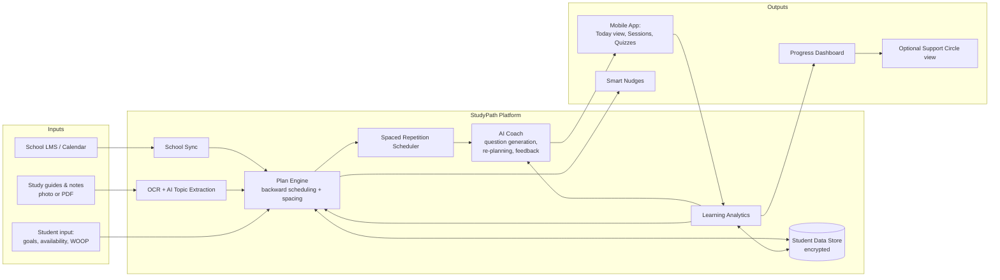
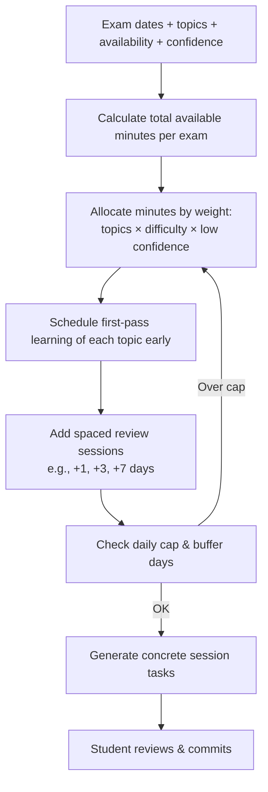
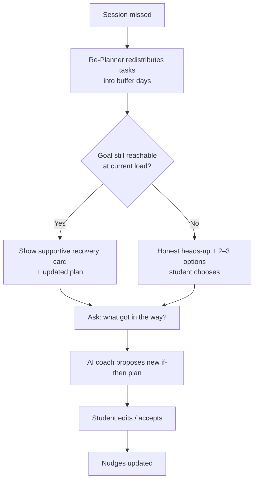

# User Journey: "StudyPath" — A Self-Regulated Learning System for Finals Preparation

**Document type:** User Journey & Solution Concept
**Version:** 1.0 (Draft)
**Date:** November 25, 2026
**Companion document:** *Problem Definition: High School Study Planning & Follow-Through* (v1.0)

---

## 1. Purpose

This document describes the end-to-end journey of our target user through **StudyPath**, a proposed software solution that helps a high school student build a finals study plan, stick to it, and reach his goal of 90%+ on every final.

Every stage of the journey is grounded in **Self-Regulated Learning (SRL)** research. SRL describes how effective learners plan, monitor, and reflect on their own learning. StudyPath's job is not to "do the studying" for the student. It is to provide the external structure (scaffolding) that a 15-year-old's still-developing planning skills can't yet provide on their own, while gradually building his ability to self-regulate.

> **Note on naming:** "StudyPath" is a working name for the concept only.

---

## 2. Problem Recap

> **Alex**, a motivated 15-year-old high school student, **needs** a way to turn the overwhelming task of preparing for finals into a clear, realistic plan he can actually follow day by day, **because** without that structure he puts off studying until it's too late, and ends up with grades below the A's he's working toward.

The problem chain StudyPath must break:

```
[1] Can't build a plan → [2] Can't stick to a plan → [3] Procrastination → [4] Grade < 90%
```

---

## 3. Research Foundation

### 3.1 Core Framework: Zimmerman's Cyclical Model of SRL

The journey is organized around Zimmerman's cyclical model, one of the most widely used SRL frameworks. It is grounded in social cognitive theory and has three repeating phases (Panadero & Alonso-Tapia, 2014):

| SRL Phase | What the Learner Does | Where It Appears in StudyPath |
|---|---|---|
| **1. Forethought** | Analyzes the task, sets goals, plans strategies, builds motivation and self-efficacy | Onboarding, goal setting, plan generation |
| **2. Performance** | Executes the plan, controls attention, uses strategies, self-monitors | Daily study sessions, focus mode, retrieval practice |
| **3. Self-Reflection** | Evaluates results, makes attributions ("why did that work?"), adapts for next time | Daily check-ins, weekly reviews, post-exam reflection |

The model is **cyclical**: each round of reflection feeds the next round of planning. StudyPath runs this cycle at three time scales: **per session**, **per week**, and **per exam season**.

### 3.2 Evidence-Based Principles and How They Shape the Design

| # | Research Principle | Key Evidence | Design Implication |
|---|---|---|---|
| P1 | **SRL can be taught to secondary students** | A meta-analysis of 35 secondary-school intervention studies found SRL can be fostered effectively (Dignath & Büttner, 2008). | The app should *teach* planning skills, not just do planning *for* him. |
| P2 | **Mental Contrasting with Implementation Intentions (MCII / "WOOP")** | A 2021 meta-analysis of 21 studies (15,907 participants) found MCII improves goal attainment with a small-to-medium effect (g = 0.336) (Wang et al., 2021). MCII has also been shown to improve students' time management (Oettingen et al., 2015). | Goal setting uses **Wish → Outcome → Obstacle → Plan**, ending in "If [obstacle], then I will [action]" plans. |
| P3 | **Spaced practice** | The same time spent studying produces more learning when spread out rather than crammed (Carpenter, Pan & Butler, 2022; Weinstein et al., 2018). | Plans are built **backward from exam dates** and spread across days; cramming is designed out. |
| P4 | **Retrieval practice** | Retrieval practice consistently benefits learning in real school classrooms (Agarwal, Nunes & Blunt, 2021). | Sessions are built around **self-quizzing**, not re-reading. |
| P5 | **Self-monitoring tools improve achievement** | A meta-analysis of 32 studies found monitoring tools (journals, rubrics, etc.) had a moderate effect on achievement (d = 0.42) (Hoppe et al., 2023). | Built-in progress tracking, confidence ratings, and reflection journal. |
| P6 | **Digital prompts scaffold learning** | A meta-analysis of 68 experiments found prompts in digital learning have a moderate positive effect (d = 0.39) (Thomann & Deutscher, 2025). | Short, well-timed prompts before, during, and after sessions. |
| P7 | **Combined scaffolds work best** | A 2023 meta-analysis found regulated-learning scaffolding had a moderate effect (g = 0.587), with composite tools having the greatest effect (Shao et al., 2023). | StudyPath combines planning, monitoring, prompts, and reflection in one system rather than offering one isolated feature. |
| P8 | **Procrastination is an SRL failure, influenced by situation** | Reviews frame academic procrastination as a failure of self-regulation that also depends on the situation (Zacks & Hen, 2018). Most recent interventions studied reduced procrastination (Turner & Hodis, 2023). | Address both **skills** (planning) and **environment** (distractions, task size). |
| P9 | **Supportive beats punitive** | A 2026 systematic review found supportive designs reliably outperform punitive or restrictive ones, and that one-size-fits-all interventions benefit students unevenly (Cheng et al., 2026). | No shaming, no harsh streak-loss penalties; personalize to the student. |
| P10 | **AI can support SRL, with care** | A 2026 meta-analysis examined how AI-based interventions affect learners' SRL strategies (Zhang & Li, 2026). Researchers also note many SRL tools lack real-time feedback and adaptive scaffolding (Wang et al., 2025, *SRLAgent*). | Use AI for **adaptive re-planning and coaching**, while requiring the student to make key decisions himself. |

### 3.3 Important Cautions From the Research

- **Teens may benefit less from some interventions.** One 2024 meta-analysis found secondary students benefited *least* from monitoring-accuracy interventions compared with younger students and adults, and classroom effects were smaller than lab effects (Prinz-Weiß et al., 2024). StudyPath must be engaging and low-friction to work in real life.
- **No strategy works for everyone.** Spacing, retrieval, and interleaving don't always guarantee more learning (Hartwig, et al. / *"One size does not fit all,"* 2024). The system must adapt based on each student's actual results.
- **Students underuse strategies that feel hard.** Effective strategies are underused partly because they are counter-intuitive (Carpenter et al., 2022). StudyPath must explain *why* and show proof of progress.

---

## 4. Solution Overview: StudyPath

### 4.1 Concept

StudyPath is a mobile-first app (with web companion) that acts as a **personal study coach**. It connects to the student's school calendar, builds a realistic study plan for each final, guides each study session, and automatically adjusts the plan when he falls behind.

### 4.2 System Components

| Component | What It Does | Technology / Process | SRL Phase |
|---|---|---|---|
| **A. School Sync** | Imports class list, exam dates, and unit topics | Integration with school learning management systems (e.g., Google Classroom, Canvas, Schoology) via APIs or calendar (.ics) import; manual entry fallback | Forethought |
| **B. Syllabus Scanner** | Turns a study guide or syllabus into a topic list | Photo/PDF upload → OCR (text recognition) → AI language model extracts topics and estimates difficulty; student confirms | Forethought |
| **C. Goal & WOOP Builder** | Guides goal setting and if-then planning | Conversational flow (chat-style interface) using the WOOP script; saves if-then plans as triggers | Forethought |
| **D. Plan Engine** | Builds a day-by-day study schedule | Backward-scheduling algorithm from exam dates; spaced-repetition intervals; respects availability (sports, homework) pulled from the student's calendar | Forethought |
| **E. Session Coach** | Runs each study session | Timed focus blocks (e.g., 25 min); pre-session goal prompt; retrieval-practice quizzes; post-session reflection | Performance |
| **F. Practice Generator** | Creates self-quiz questions and flashcards | AI generates questions from the student's own notes/topics; spaced-repetition scheduler (e.g., an SM-2 / FSRS-style algorithm) decides when to review | Performance |
| **G. Focus Mode** | Reduces distractions during sessions | Uses phone's built-in focus/screen-time APIs (iOS Screen Time, Android Digital Wellbeing) with student opt-in | Performance |
| **H. Smart Nudges** | Prompts at the right moment | Push notifications triggered by schedule, location/time context, and the student's own if-then plans | Performance |
| **I. Adaptive Re-Planner** | Recovers the plan after a missed session | Rules + AI re-distributes missed work across remaining days; flags if the goal is at risk | Performance → Reflection |
| **J. Progress Dashboard** | Shows readiness per class | Learning analytics: quiz accuracy, topics mastered, confidence vs. actual performance, predicted readiness | Self-Reflection |
| **K. Reflection Journal** | Builds self-awareness | Daily 30-second check-in; weekly review; post-exam "exam wrapper" | Self-Reflection |
| **L. Support Circle (optional)** | Light accountability | Student-controlled sharing with a parent, friend, or study buddy (progress only, never private reflections) | All phases |

### 4.3 Technical Architecture (High Level)



---

## 5. Persona Snapshot

| Attribute | Detail |
|---|---|
| **Name** | Alex |
| **Age / Grade** | 15, sophomore |
| **Goal** | A (90%+) on all six finals |
| **Finals window** | Mid-December (approx. 3 weeks away at journey start) |
| **Schedule** | School 7:30–2:30; basketball practice 3:00–5:00 on weekdays; homework most evenings |
| **Devices** | Smartphone (primary), school Chromebook |
| **Pain points** | Overwhelmed by material; plans fall apart after a missed day; phone distractions; tends to cram |

---

## 6. The User Journey

The journey has **eight stages**, grouped into Zimmerman's three SRL phases. Stages 4–6 repeat daily and weekly until exams.

```
 FORETHOUGHT                     PERFORMANCE                        SELF-REFLECTION
┌───────────────────────┐  ┌──────────────────────────────┐  ┌──────────────────────┐
│ 1 Discover            │  │ 4 Daily Study Sessions       │  │ 7 Exam Week          │
│ 2 Onboard & Set Goals │→ │ 5 Slip & Recover             │→ │ 8 Reflect & Reset    │
│ 3 Build the Plan      │  │ 6 Weekly Check-In            │  │                      │
└───────────────────────┘  └──────────────────────────────┘  └──────────────────────┘
          ↑                              ↺ repeats                        │
          └──────────────────── feeds the next exam cycle ────────────────┘
```

---

### Stage 1 — Discover

**Timing:** ~3–4 weeks before finals
**SRL phase:** Pre-forethought (motivation)

| Element | Detail |
|---|---|
| **User goal** | "I need to do better on finals than last time." |
| **Trigger** | Teacher announces the finals schedule; a friend mentions the app; parent suggests it; or school recommends it. |
| **User actions** | Downloads app; skims the welcome screens. |
| **Touchpoints** | App store listing, school counselor recommendation, friend referral link. |
| **System / tech process** | Account creation with school email (single sign-on); age-appropriate privacy notice; optional parent consent flow where required. |
| **Thinking** | "Is this just another planner I'll stop using in two days?" |
| **Feeling** | 😐 Skeptical, slightly anxious about finals. |
| **Pain points** | Past failed attempts with planners; low trust in "productivity" apps. |
| **Design response** | Welcome screen promises one thing clearly: *"Tell us your exam dates. We'll build the plan. You just show up."* Setup takes under 10 minutes. |
| **Research link** | P8 (address the situation, not just willpower), P9 (supportive tone). |

---

### Stage 2 — Onboard & Set Goals

**Timing:** Day 1 (≈10 minutes)
**SRL phase:** Forethought — goal setting, self-motivation

| Element | Detail |
|---|---|
| **User goal** | "Figure out what I actually need to do." |
| **User actions** | 1. Connects school account or enters classes manually. 2. Confirms exam dates. 3. Sets a target grade per class (default 90%+). 4. Rates current confidence per class (1–5). 5. Completes a **WOOP** exercise for finals. |
| **Touchpoints** | Onboarding flow, chat-style coach screen. |
| **System / tech process** | **School Sync** pulls classes and exam dates via LMS API/calendar import. **Goal & WOOP Builder** runs a guided script: <br>• **Wish:** "What do you want?" → *"A's on all my finals."* <br>• **Outcome:** "Imagine getting there. How does it feel?" → *"Keeping my GPA up for basketball and my parents off my back."* <br>• **Obstacle:** "What inside you gets in the way?" → *"I get on my phone after practice and lose the whole night."* <br>• **Plan:** "If [obstacle], then I will…" → *"**If** I get home from practice, **then** I'll put my phone in the kitchen and do one 25-minute session before dinner."* <br>The if-then plan is saved as a trigger for Smart Nudges. |
| **Thinking** | "Okay, that's actually what happens every night." |
| **Feeling** | 🙂 Understood; a little more hopeful. |
| **Pain points** | Data entry is boring; vague goals ("study more"). |
| **Design response** | Auto-import minimizes typing. The coach rejects vague plans and asks follow-up questions ("When exactly? Where?"). |
| **Research link** | P2 (MCII/WOOP), P1 (teaching goal-setting skills). |

---

### Stage 3 — Build the Plan

**Timing:** Day 1–2 (≈10–15 minutes)
**SRL phase:** Forethought — task analysis, strategic planning

| Element | Detail |
|---|---|
| **User goal** | "Turn six huge finals into something doable." |
| **User actions** | 1. Snaps photos of each study guide (or app pulls unit topics from LMS). 2. Reviews and edits the topic list. 3. Marks weekly availability (blocks out practice, games, family time). 4. Reviews the generated plan and adjusts if needed. 5. Taps **"Commit to my plan."** |
| **Touchpoints** | Camera/upload screen, topic checklist, availability grid, plan preview (calendar and list view). |
| **System / tech process** | **Syllabus Scanner:** OCR extracts text → AI identifies topics, groups them into units, and estimates effort. Student confirms each list (keeps him in control and builds task-analysis skill). <br>**Plan Engine:** <br>1. Counts available study minutes before each exam. <br>2. Weights subjects by **exam date**, **number of topics**, and **student's confidence rating** (low confidence = more time). <br>3. Schedules **first exposure** of each topic early, then **spaced review** sessions at growing intervals. <br>4. Caps daily load at a realistic level (e.g., 2–3 sessions on practice days, more on weekends). <br>5. Leaves **buffer days** for catch-up. <br>6. Exports sessions to the phone calendar. |
| **Thinking** | "Wait, it's only 50 minutes a day? I can do that." |
| **Feeling** | 😃 Relief; the mountain is now a staircase. |
| **Pain points** | Plans that are too ambitious collapse fast. |
| **Design response** | Engine deliberately under-schedules and builds in buffers. Each session has a **specific, startable task** (e.g., *"Biology: Quiz yourself on cell transport — 15 questions"*), never just "study bio." |
| **Research link** | P3 (spacing), P1 (task analysis), Problem doc §4.1 (overwhelm, unrealistic planning). |

**Plan Engine logic (simplified):**



---

### Stage 4 — Daily Study Sessions (Repeats Daily)

**Timing:** Every scheduled day until exams
**SRL phase:** Performance — self-control, strategy use, self-monitoring

| Element | Detail |
|---|---|
| **User goal** | "Get today's sessions done without it taking all night." |
| **User actions** | 1. Gets a nudge at his if-then moment. 2. Opens **Today** view → sees 2 sessions. 3. Taps **Start**. 4. Sets a mini-goal. 5. Works through a retrieval-practice quiz and focused review. 6. Rates confidence. 7. Done; gets a short summary. |
| **Touchpoints** | Push notification, Today screen, Session screen, quiz cards, completion screen. |
| **System / tech process** | **Smart Nudges** fire based on his if-then plan (e.g., 5:15 PM, when he's typically home from practice): *"You're home. Phone in the kitchen, one session before dinner. ~25 min."* <br>**Focus Mode** (opt-in) activates the phone's focus API to silence chosen apps for the session. <br>**Session Coach** flow: <br>• **Before (prompt):** "What's your goal for this session?" (e.g., "Get 80% on photosynthesis questions.") <br>• **During:** **Practice Generator** serves retrieval questions first, then targeted review of missed items. Spaced-repetition scheduler logs each answer. <br>• **After (prompt):** "How confident are you on this topic now? (1–5)" and "What worked?" <br>**Learning Analytics** compares confidence vs. actual accuracy to spot over- or under-confidence. |
| **Thinking** | "Quizzing myself is harder than re-reading… but I can actually see what I don't know." |
| **Feeling** | 😤 → 😊 Effortful during, satisfied after. |
| **Pain points** | Starting is the hardest part; retrieval feels harder than re-reading, so he may want to skip it. |
| **Design response** | Sessions are short and start with one easy question to build momentum. A one-line explainer appears in early sessions: *"Struggling to remember is what makes it stick."* Completion shows concrete progress (e.g., *"Cell transport: 55% → 80%"*). |
| **Research link** | P4 (retrieval), P5 (self-monitoring), P6 (prompts before/during/after), §3.3 (students resist hard strategies). |

---

### Stage 5 — Slip & Recover (Triggered by a Missed Session)

**Timing:** Any time a session is missed
**SRL phase:** Performance → Self-Reflection (adaptive control)

This is the **most critical stage** of the journey. In the problem definition, the student's plans fail because one missed day makes the whole plan feel "broken."

| Element | Detail |
|---|---|
| **User goal** | "I messed up yesterday. Is there any point now?" |
| **Trigger** | Session not started within a window after its scheduled time; or student taps "Can't today." |
| **User actions** | 1. Opens app the next day. 2. Sees a recovery message, not a failure message. 3. Answers one quick question about what got in the way. 4. Accepts the updated plan. |
| **Touchpoints** | Recovery card on Today screen, quick-reason picker, updated plan preview. |
| **System / tech process** | **Adaptive Re-Planner:** <br>1. Redistributes the missed tasks across remaining days and buffer slots. <br>2. Recalculates readiness forecast per class. <br>3. If the 90% goal is at risk, flags it honestly and offers options (e.g., "Add one weekend session" or "Focus extra time on Chemistry"). <br>**Obstacle capture:** Student picks a reason (tired, game ran late, phone, forgot, didn't know how to start). AI coach suggests a new or updated if-then plan for that obstacle. <br>**Tone rules:** No guilt language, no "streak lost" alarms. |
| **Thinking** | "Oh, okay. It's not ruined. I just have to do a bit more Saturday." |
| **Feeling** | 😟 → 😌 Guilt replaced with a path forward. |
| **Pain points** | All-or-nothing thinking; shame leading to app avoidance. |
| **Design response** | Message example: *"Yesterday didn't happen — that's normal. We moved it to Saturday morning. You're still on track for an A in Bio."* Recovery is one tap. |
| **Research link** | P9 (supportive over punitive), P2 (refreshing if-then plans for new obstacles), P10 (AI adaptive re-planning), Problem doc §4.2 (all-or-nothing thinking, rigid plans). |

**Recovery flow:**



---

### Stage 6 — Weekly Check-In (Repeats Weekly)

**Timing:** Sunday evening (≈5 minutes)
**SRL phase:** Self-Reflection → Forethought (closing the loop)

| Element | Detail |
|---|---|
| **User goal** | "Am I actually on track?" |
| **User actions** | 1. Opens weekly review. 2. Sees readiness per class. 3. Answers 3 reflection questions. 4. Adjusts next week's availability (e.g., away game Thursday). 5. Optionally shares a progress snapshot with his Support Circle. |
| **Touchpoints** | Weekly Review screen, Progress Dashboard, share card. |
| **System / tech process** | **Progress Dashboard** shows per class: topics mastered, quiz accuracy trend, sessions completed, and a **readiness meter** (on track / at risk). <br>**Reflection Journal** prompts: <br>1. "What went well this week?" <br>2. "What got in the way?" <br>3. "What's one thing you'll do differently?" <br>**Calibration feedback:** Shows where confidence didn't match quiz results (e.g., *"You rated Algebra 4/5, but scored 62%. Let's add a review."*). <br>**Plan Engine** re-runs for the next week using new availability and performance data. |
| **Thinking** | "I'm crushing History but Chemistry is behind. Makes sense; I've been avoiding it." |
| **Feeling** | 🤔 → 💪 Clarity and ownership. |
| **Pain points** | Reflection can feel like homework; teens may skip it. |
| **Design response** | Keep it to 3 questions with tap-to-answer options plus optional text. Show visual progress first (reward), then reflection. |
| **Research link** | P5 (monitoring tools), Zimmerman self-reflection phase (attributions and adaptation), §3.3 (monitoring accuracy is harder for teens, so give explicit calibration feedback). |

---

### Stage 7 — Exam Week

**Timing:** Final 5–7 days
**SRL phase:** Performance (high-stakes) + Self-Reflection

| Element | Detail |
|---|---|
| **User goal** | "Walk into each exam feeling ready, not panicked." |
| **User actions** | 1. Follows a lighter, review-focused schedule. 2. Takes a full **practice test** for each class. 3. Reviews only weak topics. 4. Gets night-before reminders. |
| **Touchpoints** | Exam Mode Today view, Practice Test screen, readiness summary, night-before notification. |
| **System / tech process** | **Exam Mode** switches the Plan Engine from learning new material to **mixed review**. <br>**Practice Generator** builds a cumulative practice test from all topics, weighted toward weaker ones. <br>Readiness summary: *"You've mastered 18 of 21 Biology topics. Review these 3 tonight."* <br>**Wellbeing prompts:** Night-before nudge recommends sleep over late cramming; exam-morning card offers a brief confidence reminder of work completed. |
| **Thinking** | "I've actually studied this. I know what I know." |
| **Feeling** | 😬 → 😎 Nervous but prepared. |
| **Pain points** | Temptation to pull all-nighters; test anxiety. |
| **Design response** | App highlights the total work done (e.g., *"22 sessions, 340 questions answered"*) to build self-efficacy. No new material in the last 24 hours. |
| **Research link** | P4 (practice testing), P3 (cumulative spaced review), Zimmerman forethought (self-efficacy). |

---

### Stage 8 — Reflect & Reset (After Grades Are Posted)

**Timing:** After exam results are released
**SRL phase:** Self-Reflection → next cycle's Forethought

| Element | Detail |
|---|---|
| **User goal** | "Did it work? What do I do next semester?" |
| **User actions** | 1. Enters (or syncs) final grades. 2. Completes a 2-minute **exam wrapper** per class. 3. Reviews his personal "What works for me" summary. 4. Opts into using StudyPath for unit tests next semester. |
| **Touchpoints** | Results screen, exam wrapper, personal insights card. |
| **System / tech process** | **Grade sync** via LMS (or manual entry). <br>**Exam wrapper** prompts: "How did you prepare? Which topics surprised you? What will you change?" <br>**Learning Analytics** links behavior to results (e.g., *"Classes where you did 10+ spaced sessions averaged 93%. Classes with fewer than 5 averaged 84%."*). <br>System saves a **personal study profile** (best times, best session length, obstacles that worked with if-then plans) to improve the next plan. <br>Over time, the app **reduces scaffolding** (fewer prompts, student builds more of the plan himself) to build independent skill. |
| **Thinking** | "Spacing it out actually worked. I want to do this for every big test." |
| **Feeling** | 🎉 Proud (goal met) **or** 🙁 → 🧭 Disappointed but with a clear reason and next step (goal missed). |
| **Pain points** | If he misses the goal, risk of blaming himself ("I'm just bad at school"). |
| **Design response** | Attributions are steered toward **strategy and effort** ("Chemistry had the fewest sessions") rather than ability. |
| **Research link** | Zimmerman self-reflection (causal attributions, adaptive reactions), P1 (building lasting SRL skill), P5. |

---

## 7. Emotional Journey Summary

| Stage | Emotion | Intensity (1 = low, 5 = high positive) | Key Moment of Truth |
|---|---|---|---|
| 1. Discover | Skeptical, anxious | 2 | "Is this worth my time?" |
| 2. Onboard & Set Goals | Understood, hopeful | 3 | WOOP names his real obstacle |
| 3. Build the Plan | Relief | 4 | Seeing a doable daily load |
| 4. Daily Sessions | Effort → satisfaction | 3–4 | Seeing quiz scores rise |
| 5. Slip & Recover | Guilt → relief | 2 → 4 | **Plan survives a missed day** |
| 6. Weekly Check-In | Clarity, ownership | 4 | Readiness meter shows "on track" |
| 7. Exam Week | Nervous → confident | 3–4 | "I know what I know" |
| 8. Reflect & Reset | Proud / motivated | 5 | Linking effort to the A |

```
Emotion
  5 |                                                              ●
  4 |                 ●        ●                 ●        ●
  3 |        ●                  \       ●
  2 |  ●                          ●  (slip)
  1 |
    +----+--------+--------+--------+--------+--------+--------+--------
      Discover  Onboard   Plan   Sessions  Recover  Weekly   Exam   Reflect
```

**The critical moment is Stage 5.** If the app gets slips right, the student stays engaged; if it gets them wrong (guilt, broken plan), he quits, just like with past planners.

---

## 8. How the Journey Breaks the Problem Chain

| Problem Link (from Problem Definition) | Root Causes Addressed | Journey Stage(s) | StudyPath Mechanism |
|---|---|---|---|
| **[1] Can't build a plan** | Overwhelm, unclear scope, no method, multiple exams, unrealistic plans | 2, 3 | School Sync, Syllabus Scanner, Plan Engine with backward scheduling, daily caps, buffers |
| **[2] Can't stick to the plan** | Distant reward, no accountability, all-or-nothing thinking, rigid plans, no visible progress, vague tasks | 4, 5, 6 | If-then nudges, concrete session tasks, Adaptive Re-Planner, progress dashboard, optional Support Circle |
| **[3] Procrastination** | Avoidance, fear of failure, false confidence in cramming, distractions | 2, 4, 7 | WOOP obstacles, momentum-building sessions, Focus Mode, calibration feedback, spaced scheduling that prevents cramming |
| **[4] Grade < 90%** | Cramming, poor retention, test anxiety | 4, 7, 8 | Retrieval + spaced practice, practice tests, exam-week wellbeing, reflection loop |

---

## 9. Success Metrics by Stage

| Stage | Metric | Target (initial hypothesis) |
|---|---|---|
| 1–2 | Onboarding completion rate | ≥ 80% of downloads complete setup |
| 2 | Students with at least one specific if-then plan | ≥ 90% |
| 3 | Plan committed ≥ 14 days before first final | ≥ 75% |
| 4 | Planned sessions completed | ≥ 75% |
| 4 | Sessions that include retrieval practice | ≥ 90% |
| 5 | Return to plan within 48 hours after a missed session | ≥ 70% |
| 6 | Weekly check-ins completed | ≥ 3 of 4 weeks |
| 6 | Confidence-accuracy gap (calibration) | Decreases over the season |
| 7 | Practice test completed per final | ≥ 1 per class |
| 8 | **Finals at 90%+** | Increase vs. student's previous semester |
| 8 | Self-reported stress before finals | Lower than previous semester |
| 8 | Retention: opts in for next semester | ≥ 60% |

---

## 10. Privacy, Safety & Ethics Considerations

Because the user is a **minor**, the following are required design constraints:

- **Data minimization:** Collect only what the plan needs; no selling or advertising use of student data.
- **Legal compliance:** Review applicable student-privacy laws (e.g., FERPA when using school data, state student-privacy laws, and parental-consent rules where they apply) with legal counsel before launch.
- **Student control:** The student decides what the Support Circle can see. Reflection journal entries are always private.
- **Supportive design:** No punitive mechanics, no shaming notifications, no manipulative engagement loops (P9).
- **AI guardrails:** AI-generated questions and plans are reviewable by the student; AI content stays on-topic and age-appropriate; students can report errors.
- **Wellbeing:** Daily study caps, sleep-friendly notification hours, and a path to a trusted adult or school counselor if the student reports high stress.
- **Academic integrity:** The AI coach helps him practice and plan; it does not complete graded assignments.

---

## 11. Risks & Mitigations

| Risk | Evidence / Reason | Mitigation |
|---|---|---|
| Teen disengages after a few days | Secondary students benefited least in some interventions; real-world effects are smaller than lab effects | Short sessions, visible progress, supportive recovery, minimal setup |
| Retrieval practice feels too hard, student reverts to re-reading | Effective strategies are underused because they feel counter-intuitive | Explain the "why," start sessions easy, show measurable score gains |
| Plan too rigid for a busy athlete | Problem doc §4.2 (rigid plans) | Availability syncing, buffers, one-tap rescheduling |
| AI generates wrong topics or questions | AI output can be inaccurate | Student confirms topic lists; flag-an-error button; teacher materials prioritized as sources |
| Over-reliance on the app | SRL goal is independent skill | Gradually fade scaffolding over semesters |
| One size doesn't fit all | Strategy effects vary by learner and content | Personal study profile; plan engine adapts using each student's results |

---

## 12. Open Questions & Next Steps

**Open questions**
1. Which LMS platforms do target schools use, and what data can apps access?
2. Will students actually photograph study guides, or do teachers need to share them directly?
3. How much parent involvement does the persona want (if any)?
4. What session length works best for this age group in practice?
5. Should StudyPath be sold to families directly, or adopted through schools?

**Next steps**
1. **Validate the journey** with 5–10 students matching the persona (walk them through each stage with paper or clickable prototypes).
2. **Prototype Stages 2, 3, and 5 first** — goal setting, plan building, and slip recovery are the highest-risk, highest-value moments.
3. **Pilot during one finals season** with a small group and measure against Section 9.
4. **Refine** the Plan Engine weights and nudge timing based on pilot data.

---

## 13. References

- Agarwal, P. K., Nunes, L. D., & Blunt, J. R. (2021). Retrieval practice consistently benefits student learning: A systematic review of applied research in schools and classrooms. *Educational Psychology Review, 33*, 1409–1453.
- Carpenter, S. K., Pan, S. C., & Butler, A. C. (2022). The science of effective learning with spacing and retrieval practice. *Nature Reviews Psychology.* https://www.nature.com/articles/s44159-022-00089-1
- Cheng, D., Heath, O., Farooqi, D., Chou, E., Gao, A., & Calver, J. (2026). Systematic review of academic procrastination interventions in computing higher education. *arXiv:2604.03248.* https://arxiv.org/abs/2604.03248
- Dignath, C., & Büttner, G. (2008). Components of fostering self-regulated learning among students: A meta-analysis on intervention studies at primary and secondary school level. *Metacognition and Learning, 3*, 231–264. https://doi.org/10.1007/s11409-008-9029-x
- Hoppe, L., et al. (2023). Let learners monitor the learning content and their learning behavior! A meta-analysis on the effectiveness of tools to foster monitoring. *Educational Psychology Review, 35*, 62. https://doi.org/10.1007/s10648-023-09718-4
- Oettingen, G., Kappes, H. B., Guttenberg, K. B., & Gollwitzer, P. M. (2015). Self-regulation of time management: Mental contrasting with implementation intentions. *European Journal of Social Psychology.*
- Panadero, E. (2017). A review of self-regulated learning: Six models and four directions for research. *Frontiers in Psychology, 8*, 422. https://pmc.ncbi.nlm.nih.gov/articles/PMC5408091
- Panadero, E., & Alonso-Tapia, J. (2014). How do students self-regulate? Review of Zimmerman's cyclical model of self-regulated learning. *Anales de Psicología, 30*(2). https://doi.org/10.6018/analesps.30.2.167221
- Prinz-Weiß, A., et al. (2024). Meta-analysis of interventions to improve monitoring accuracy in problem-solving tasks. *Educational Psychology Review.* https://doi.org/10.1007/s10648-024-09936-4
- Shao, J., Chen, Y., Wei, X., Li, X., & Li, Y. (2023). Effects of regulated learning scaffolding on regulation strategies and academic performance: A meta-analysis. *Frontiers in Psychology, 14*, 1110086. https://doi.org/10.3389/fpsyg.2023.1110086
- Thomann, H., & Deutscher, V. (2025). Effective scaffolding through prompts in digital learning: A meta-analysis and systematic review. (Summary: https://www.edtech.tum.de/?p=2940)
- Turner, M., & Hodis, F. A. (2023). A systematic review of interventions to reduce academic procrastination and implications for instructor-based classroom interventions. *Educational Psychology Review.* https://doi.org/10.1007/s10648-023-09838-x
- "One size does not fit all": Heterogeneity in spacing, interleaving, and retrieval practice (2024). https://pmc.ncbi.nlm.nih.gov/articles/PMC10950551
- Wang, G., Wang, Y., & Gai, X. (2021). A meta-analysis of the effects of mental contrasting with implementation intentions on goal attainment. *Frontiers in Psychology, 12*, 565202. https://doi.org/10.3389/fpsyg.2021.565202
- Wang, et al. (2025). SRLAgent: Enhancing self-regulated learning skills through gamification and LLM assistance. *arXiv:2506.09968.* https://arxiv.org/pdf/2506.09968
- Weinstein, Y., Madan, C. R., & Sumeracki, M. A. (2018). Teaching the science of learning. *Cognitive Research: Principles and Implications, 3*, 2. https://doi.org/10.1186/s41235-017-0087-y
- Zacks, S., & Hen, M. (2018). Academic interventions for academic procrastination: A review of the literature. *Journal of Prevention & Intervention in the Community, 46*(2), 117–130.
- Zhang, Z., & Li, B. (2026). A meta-analysis of AI-assisted self-regulated learning. *Online Learning Journal.*
- Zimmerman, B. J. (2000). Attaining self-control: A social cognitive perspective. In M. Boekaerts, P. R. Pintrich, & M. Zeidner (Eds.), *Handbook of Self-Regulation.* Academic Press.

> **Verification note:** Author lists marked "et al." and the 2024 heterogeneity paper should be confirmed against the original publications before this document is cited externally.
